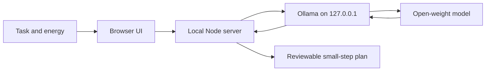

# Soft Start

**One small step for the thing you keep putting off.** Soft Start uses an open-weight model running locally in Ollama to turn one avoided task into a gentle, time-boxed starting plan.

## What it does

- Turns a short task description into one tiny first step and up to three optional next steps.
- Adapts the plan to a low, some, or plenty energy day.
- Lets you review the plan and stop as soon as the first step is done.
- Sends prompts only to Ollama on `127.0.0.1`; it has no cloud AI integration and does not save task text.
- Includes a clearly labeled sample preview that works without a model.

Soft Start does not take actions on your behalf. It does not track streaks, store tasks, or tell you that you should be doing more.

## Run it

Requirements: Node.js 20 or newer and [Ollama](https://ollama.com/) with a model installed.

```sh
ollama pull gemma3:1b
npm start
```

Open [http://127.0.0.1:4173](http://127.0.0.1:4173). Keep Ollama running in the background.

To use another locally installed Ollama model:

```sh
# macOS / Linux
OLLAMA_MODEL=llama3.2:3b npm start

# PowerShell
$env:OLLAMA_MODEL = "llama3.2:3b"; npm start
```

To run the interface without Ollama, start the server and select **Show me a sample**. The sample is fixed example content, not model output.

## How it works



The browser posts the text to this local server. The server calls Ollama's local chat endpoint using a short system prompt and JSON mode. The model only suggests a plan; it cannot execute tasks or access the filesystem. The interface escapes generated text before rendering it.

## Privacy and limits

- The Node server binds only to `127.0.0.1` by default.
- The task is sent to the Ollama service on the same computer. Soft Start has no analytics, database, cookies, external AI API, or request logging.
- The selected model can still produce an unhelpful or incorrect suggestion. Treat the result as a starting point, and skip any step that does not fit.
- Ollama and the selected model have their own license and runtime requirements; check those before redistributing a model.

## Built for Hacktoberfest Week 3

The theme is **Slow and Steady**: use open-source AI to make a tedious task easier. Soft Start uses local open-weight inference so a personal task can stay on the device, and the model can be changed without rewriting the app.

## License

MIT. See [LICENSE](LICENSE).
